<div align="center">


<br />

[](https://github.com/OtavioFelix-in/MeuBolso-Site/releases/latest)
[](https://docs.expo.dev/versions/v57.0.0/)
[](https://reactnative.dev)
[](https://docs.expo.dev/versions/v57.0.0/sdk/sqlite/)
[](https://github.com/OtavioFelix-in/MeuBolso-Site/releases/latest/download/MeuBolso.apk)

<br />

[**Baixar o APK**](https://github.com/OtavioFelix-in/MeuBolso-Site/releases/latest/download/MeuBolso.apk)
&nbsp;&nbsp;·&nbsp;&nbsp;
[**Site**](https://otaviofelix-in.github.io/MeuBolso-Site/)
&nbsp;&nbsp;·&nbsp;&nbsp;
[**Vídeo de 60 s**](https://youtube.com/shorts/s7te0wb4iUE)
&nbsp;&nbsp;·&nbsp;&nbsp;
[**Funcionalidades**](#funcionalidades)
&nbsp;&nbsp;·&nbsp;&nbsp;
[**Arquitetura**](#arquitetura)

</div>

<br />

<table>
<tr>
<td width="40%" align="center">
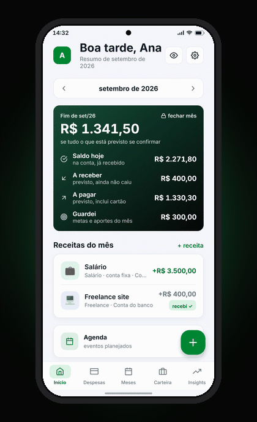
</td>
<td width="60%">

### A história

Eu precisava de um app que atendesse do jeito que **eu** organizo minha vida financeira, e não encontrei nenhum que servisse. Então criei o meu.

O **Meu Bolso** é 100% manual e offline: tudo fica salvo só no aparelho, **sem conta, sem servidor e sem anúncio**.

O objetivo não é só resolver o meu problema, é ajudar qualquer pessoa que também tenha dificuldade com o próprio dinheiro a enxergar, mês a mês, pra onde ele está indo.

> **Você lança. O app mostra para onde foi e o que isso significa.**

</td>
</tr>
</table>

<br />

## Funcionalidades

<table>
<tr>
<td width="33%" valign="top">

#### Organização

- Botão **"+"** que cadastra um lançamento **único** ou **recorrente**; a forma de pagamento decide pra onde vai o gasto (crédito usa o cartão, o resto sai da conta)
- **Contas fixas** e **variáveis** (água, energia), mensais ou anuais, com dia de vencimento
- **Parcelamentos**: parcela atual, quanto falta e quanto pesam nos meses à frente
- **Cartões de crédito** com limite, uso no mês e valor disponível
- **Categorias** personalizáveis, com emoji e cor
- **Comprovantes**: foto ou imagem anexada ao lançamento

</td>
<td width="33%" valign="top">

#### Visão do mês

- **Início** com o resultado do mês em destaque (receitas − despesas − guardado), separando o que você já tem do que ainda é previsão
- **Meses abertos e fechados**: só o mês que você abre gera as contas fixas e o salário; os demais mostram só a previsão
- **Agenda** de eventos com valor planejado × gasto real
- **Olhinho** que esconde todos os valores

</td>
<td width="33%" valign="top">

#### Patrimônio e relatórios

- **Carteira** com contas, saldos, investimentos (aportes e resgates) e bens
- **Relatórios** que respondem com números: "onde gasto mais?", "qual categoria mais cresceu?"
- **Hábitos** mês a mês e **perfil financeiro**: reserva de emergência, taxa de poupança, fluxo de caixa

</td>
</tr>
<tr>
<td colspan="3">

#### Experiência

**Bloqueio por biometria** · **lembretes** de vencimento que funcionam com o app fechado · **tema claro e escuro** · **backup** local em `.json` e `.csv` · **100% offline**, sem nenhuma conexão com a internet

</td>
</tr>
</table>

<br />

## Por dentro do app

<div align="center">

<table>
<tr>
<td align="center">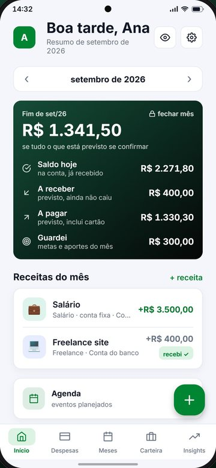<br /><sub><b>Início</b><br />o resultado do mês em destaque</sub></td>
<td align="center">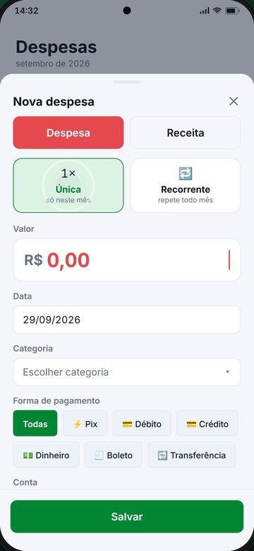<br /><sub><b>Nova despesa</b><br />única ou recorrente, crédito ou Pix</sub></td>
<td align="center">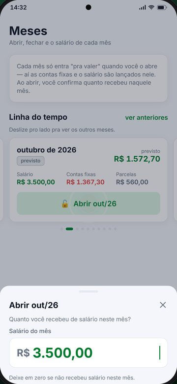<br /><sub><b>Meses</b><br />abra o mês, confirme cada conta</sub></td>
</tr>
<tr>
<td align="center">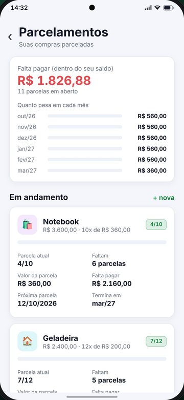<br /><sub><b>Parcelamentos</b><br />o peso de cada parcela no futuro</sub></td>
<td align="center">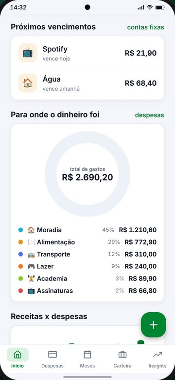<br /><sub><b>Para onde vai</b><br />categoria por categoria</sub></td>
<td align="center">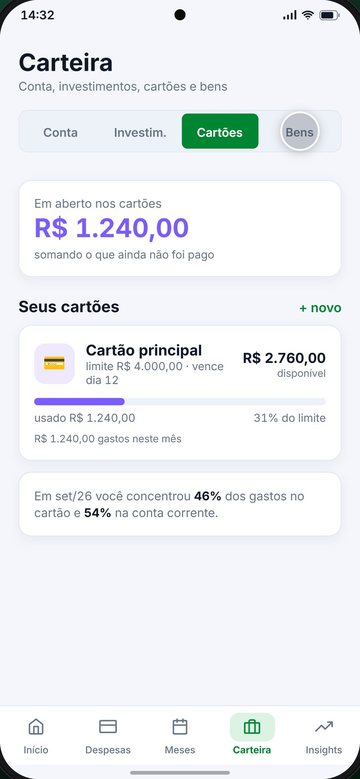<br /><sub><b>Cartões</b><br />limite, uso e quanto sobrou</sub></td>
</tr>
<tr>
<td align="center">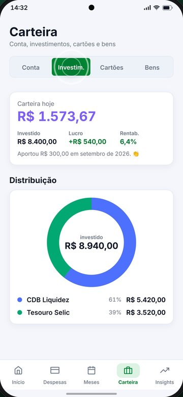<br /><sub><b>Carteira</b><br />contas, investimentos e bens</sub></td>
<td align="center"><br /><sub><b>Insights</b><br />perguntas que o app responde</sub></td>
<td align="center">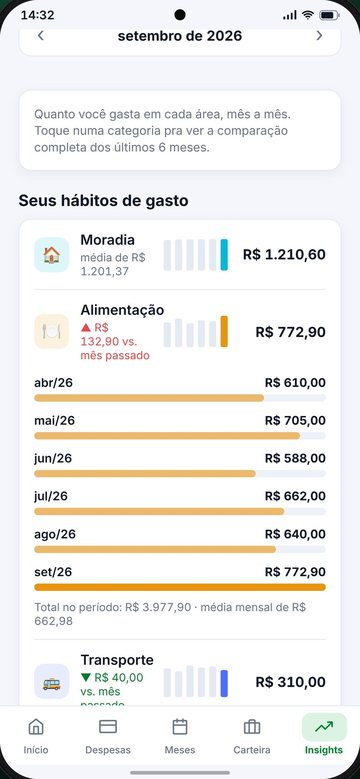<br /><sub><b>Hábitos</b><br />média e variação por categoria</sub></td>
</tr>
</table>

<sub>Prints reais do app, com dados fictícios.</sub>

</div>

<br />

## Tecnologias

| | |
|---|---|
| **React Native 0.86** + **Expo SDK 57** | base do app, JavaScript puro |
| **expo-sqlite** (API síncrona) | banco local; o app funciona sem internet |
| **expo-notifications** | lembretes locais agendados, sem servidor |
| **expo-local-authentication** | bloqueio por biometria |
| **react-native-svg** | gráficos desenhados à mão |
| **Inter** | fonte do app inteiro |
| Componentes próprios | nenhum framework de UI externo |

<br />

## Arquitetura

Offline-first: o **SQLite é a fonte da verdade** e mora no aparelho. Não existe backend.

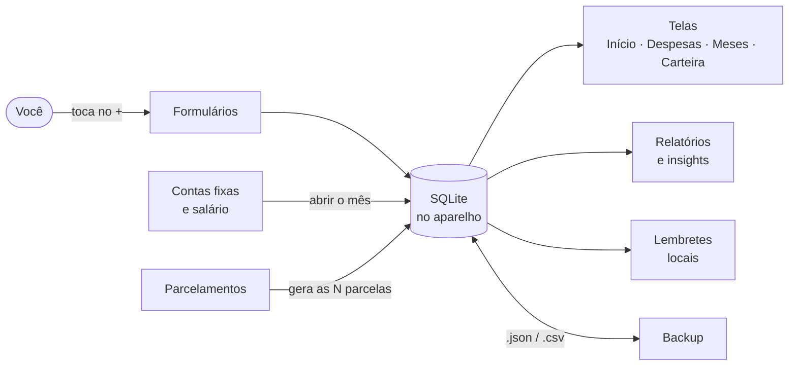

<details>
<summary><b>Estrutura de pastas</b></summary>

<br />

```
MeuBolso/
├── App.js                     # entrada: navegação à mão (abas + telas secundárias) e botão "+"
├── src/
│   ├── theme.js               # tokens: cores, espaçamento, tipografia, catálogos
│   ├── theme-context.js       # provedor de tema claro/escuro
│   ├── db/                    # SQLite, um arquivo por domínio (reexportados por index.js)
│   │   ├── core.js            #   conexão, schema, seed
│   │   ├── transactions.js    #   lançamentos (receita/despesa, previsto/pago)
│   │   ├── recurrences.js     #   contas fixas e salário
│   │   ├── installments.js    #   parcelamentos → geram as N parcelas
│   │   ├── months.js          #   mês aberto/fechado, projeção, linha do tempo
│   │   ├── cards.js           #   cartões de crédito
│   │   ├── reports.js         #   saldos e séries dos gráficos
│   │   └── backup.js          #   exportar/importar tudo + CSV
│   ├── screens/               # Início, Despesas, Meses, Carteira, Relatórios e Ajustes
│   ├── components/            # kit de UI, campos, formulários e gráficos SVG
│   ├── hooks/                 # animações de entrada e de toque
│   ├── security/              # biometria
│   ├── notifications/         # lembretes locais
│   └── utils/                 # dinheiro (centavos), datas pt-BR, comprovantes, backup
├── docs/readme/               # banner, GIF e prints deste README
└── PLANEJAMENTO.md            # planejamento do front-end
```

</details>

<details>
<summary><b>Decisões que valem lembrar</b></summary>

<br />

- **Dinheiro é sempre `INTEGER` em centavos.** Nada de `float`, então as somas batem no último centavo.
- **Datas** são `'YYYY-MM-DD'` (hora local) e meses são `'YYYY-MM'`.
- **Contas fixas e parcelas viram lançamentos de verdade**, com `paid = 0` enquanto previstos. Dashboard, agenda e relatórios leem tudo de um lugar só, e abrir o mês de novo não duplica nada.
- **Soft delete**: toda tabela tem `uuid`, `updated_at` e `deleted`, preparando o terreno pra uma futura sincronização entre aparelhos.

</details>

<br />

## Rodando o projeto

**Desenvolvimento** (com o app Expo Go no celular):

```bash
git clone https://github.com/OtavioFelix-in/MeuBolso.git
cd MeuBolso
npm install
npx expo start
```

**Gerar o APK** (build local com Android SDK e JDK 17):

```bash
npx expo prebuild --platform android --clean
cd android && ./gradlew assembleRelease
# APK em: android/app/build/outputs/apk/release/app-release.apk
```

Depois é só mandar o `.apk` para o celular, tocar nele e permitir a instalação.

> [!NOTE]
> Os lembretes **não** funcionam dentro do Expo Go (limitação do Android desde o SDK 53), mas funcionam normalmente no APK instalado.

> [!WARNING]
> No Windows, o Gradle **não compila em caminho com acento**: faça o build numa cópia em um caminho só com ASCII.

<br />

## Próximos passos

- [ ] Sincronização entre aparelhos (o modelo de dados já está preparado)
- [ ] Integração bancária, via Open Finance ou importação de OFX

<br />

---

<div align="center">


Feito por **Otávio Felix Da Silva**.

<sub>Todos os direitos reservados © Otávio Felix Da Silva. Este código é disponibilizado publicamente para visualização e portfólio, mas seu uso, cópia, modificação ou redistribuição não são autorizados sem permissão expressa do autor.</sub>

</div>
